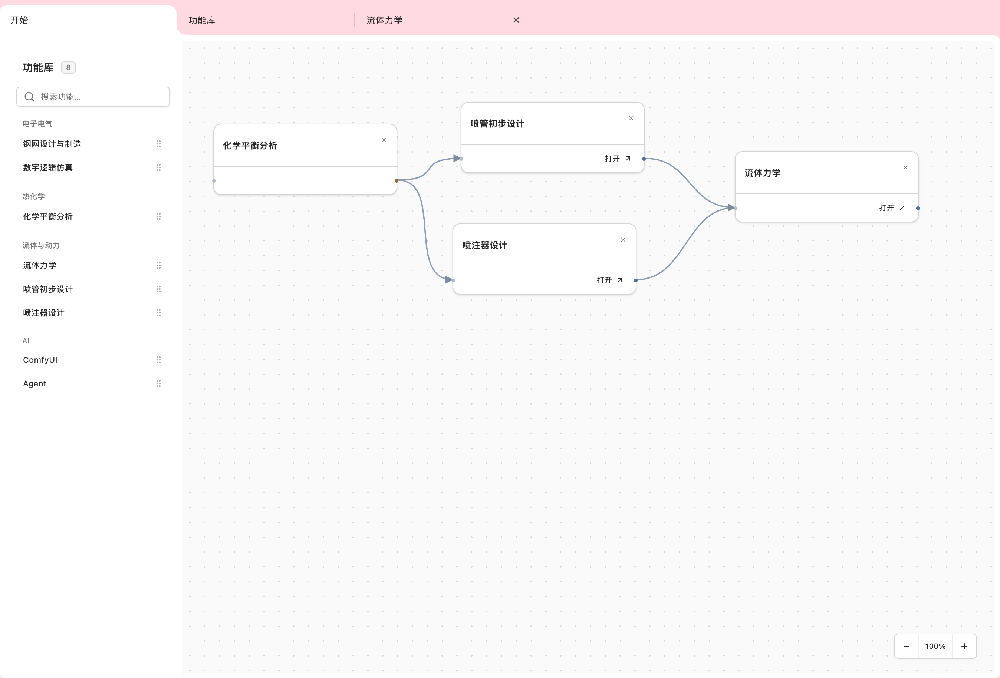
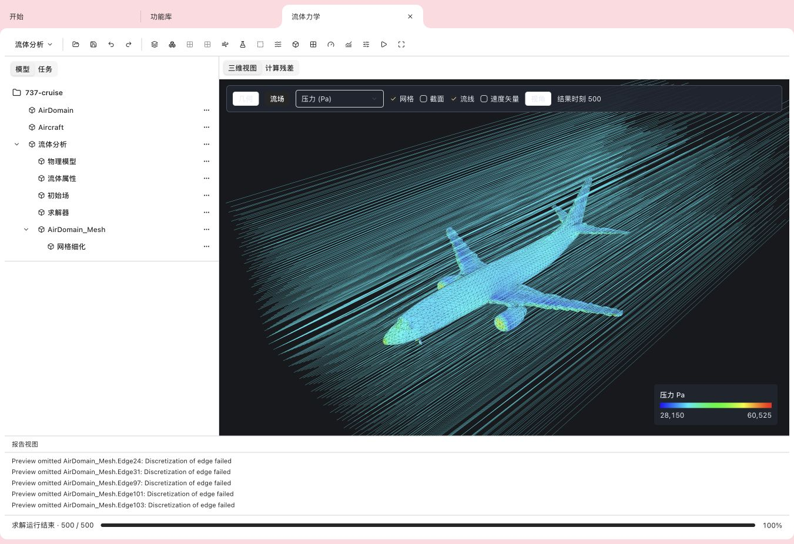
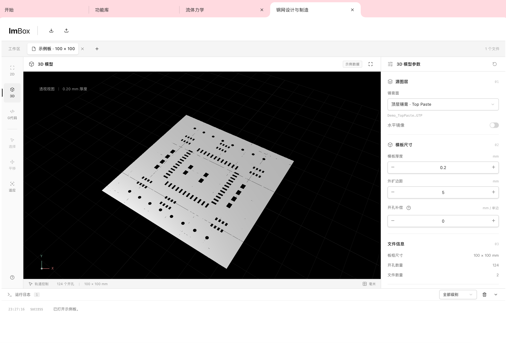

<h1 align="center">
  
  <picture>
    <source media="(prefers-color-scheme: dark)" srcset="docs/images/lmbox-wordmark-dark.svg">
    
  </picture>
</h1>

<p align="center">
  <strong>English</strong> · <a href="README.ko.md">한국어</a> · <a href="README.zh-CN.md">中文</a>
</p>

<p align="center">Building an industrial design and simulation platform for electronic components, fluids and more. Optics is planned.</p>

<p align="center">
  <a href="package.json"></a>
  <a href="LICENSE"></a>
  <a href="https://lavamilk.club"></a>
</p>

<p align="center"><sub>Custom source-available license: commercial use is prohibited; derivatives distributed or provided over a network must publish their source under the same license.<br>Read <a href="LICENSE">LICENSE</a> before use to understand the terms and avoid licensing risks. The Chinese license text is authoritative.</sub></p>

<p align="center"></p>

<p align="center"><strong>Engineering workspaces</strong><br><sub>Choose tools and organize them on the workflow canvas.</sub></p>

<p align="center"></p>

<p align="center"><strong>CFD results</strong><br><sub>Pressure colors, surface mesh, streamlines and solver progress from a computed 737 case.</sub></p>

<p align="center"></p>

<p align="center"><strong>3D stencil model · STEP export planned</strong><br><sub>Generate stencil models from Gerber, with thickness, border and aperture compensation controls. The image uses a sample board; STEP export, slicing and G-code output are planned.</sub></p>

## Architecture

A modular monolith organized by capability. Vue provides the workspaces; Rust coordinates imports, versioned tasks and native processes; Python and Fortran provide geometry and numerical capabilities. Slicer integration is planned.

```text
Vue → Desktop/development adapter → Rust → Python geometry / CFD adapters
                                        → Fortran numerical kernels
```

| Component | Responsibility | Documentation |
| --- | --- | --- |
| Vue | Feature-first workspaces, document state and 2D/3D visualization | [Frontend](frontend/agent-frontend.md) |
| Rust / Tauri | Import, parsing, versioned tasks, native process management and export | [Business core](src-rust/agent-rust.md), [Desktop host](desktop/tauri/agent-rust.md) |
| Python | Geometry evaluation, stencil models, validation and FreeCAD/CfdOF integration; OpenFOAM/HiSA solving and ParaView/VTK result reading | [Calculation engine](engine/agent-python.md) |
| Fortran | CEA thermochemistry, nozzle and injector calculations | [Numerical backend](src-fortran/agent-fortran.md) |
| Slicer (planned) | Slicing and G-code generation | [Slicing](frontend/modules/stencil/lib/features/slicing/agent-frontend-slicing.md) |
| contracts | Versioned data, commands, events and artifact formats | [Cross-language contracts](contracts/AGENTS.md) |

[Project guidelines](AGENTS.md)
